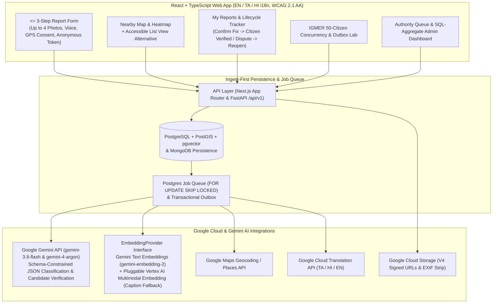

# CivicResolve — AI Civic Grievance & Incident-Clustering Platform for India

> **"One problem. Multiple citizens. One tracked incident."**
> Citizens report civic issues via text, photos, GPS, or voice in English, Tamil, or Hindi. **CivicResolve** persists every report immediately (Ingest-First), uses **Google Gemini** and **IGMER (Ingest-First Geospatial Multimodal Entity Resolution)** to merge duplicate reports into a single master incident, routes it to the responsible municipal department via configurable jurisdiction rules, and tracks it through to **citizen-verified resolution**.

---

## Architecture Overview



---

## Core Engineering Highlights

### 1. Ingest-First Citizen Reliability & Lifecycle (`citizen_reports` → `civic_incidents`)
- **Zero AI Dependency on Submission:** Every citizen submission is validated, checked against `Idempotency-Key`, assigned a tracking ID (`CR-YYYY-NNNNN`), and committed atomically with a job/outbox event before returning `201 Created`.
- **Immutable Originals:** Individual citizen reports (`citizen_reports`) are never deleted when merged into a master incident (`civic_incidents`).
- **15-State Lifecycle & Privacy Boundary:**
  `Reported → AI Analyzed → Matched/Created → Under Review → Assigned → Accepted → In Progress → Resolved → Citizen Verified → Closed` (plus `Rejected`, `Escalated`, `Reopened`, `Awaiting Info`, `needs_manual_review`).
  Every transition writes a `status_history` entry with both `public_comment` and `internal_note`. **Citizens never see internal authority notes or internal AI reasoning.**
- **Citizen Verification Loop:** When an authority marks an incident `Resolved`, supporting citizens receive an in-app notification and can **Confirm Resolution** (`→ Citizen Verified`) or **Dispute & Reopen** (`→ Reopened`). Anonymous reporters receive a private verification token (`VERIFY-CRxxxx-xxxx`).

### 2. IGMER Incident Matching & Concurrency (`src/lib/igmer-engine.ts` & `backend/app/worker.py`)
- **Candidate Retrieval:** PostGIS `ST_DWithin` (configurable radius, default 500m) + same category group + time window + `pgvector` HNSW cosine top-K. Never scans the full table.
- **Configurable Multimodal Weights:** Location **35%**, Text **30%**, Image **20%**, Category **10%**, Time **5%**. Missing images are never disqualifying — weights renormalize dynamically over available evidence.
- **Safety Guardrails:** Proximity alone never merges distinct issues, and image similarity alone cannot merge without text/category corroboration.
- **Transaction-Level Geo-Cell Advisory Lock:** Uses `pg_advisory_xact_lock(hashtextextended(geohash_category, 2026))` (and per-cell mutex locking) around match-or-create so 50+ concurrent workers cannot create duplicate master incidents.
- **Priority Function:** `Priority = f(severity, safety_risk, independent_report_count, duration, velocity)`. Report volume alone never makes a minor issue `Critical`, while a single exposed live wire (`safety_risk >= 0.85`) is immediately `Critical`. Admin overrides are recorded in `audit_logs`.

### 3. Explicit Google Services Integrations
- **Gemini API (`@google/genai` & `google-genai`):** Structured classification, image analysis, and candidate match verification using schema-constrained JSON validated with Zod / Pydantic v2.
- **Embedding Provider Interface (`EmbeddingProvider`):** Uses Gemini text embeddings (`gemini-embedding-2`) and exposes a pluggable `VertexAIMultimodalEmbeddingProvider` for image embeddings. When Vertex AI multimodal credentials are unavailable, it falls back to embedding Gemini-generated visual image captions as text.
- **Google Maps Geocoding API & Cloud Translation API:** Landmark geocoding and Tamil/Hindi/English text normalization, with graceful degradation when keys are absent.
- **Firebase Auth, Cloud Storage (V4 Signed URLs), Cloud Run & Firebase Hosting:** Full deployment configurations in [`Dockerfile`](Dockerfile), [`backend/Dockerfile`](backend/Dockerfile), [`docker-compose.yml`](docker-compose.yml), and [`firebase.json`](firebase.json).

### 4. Security, Privacy & Data Retention
- **Authentication & RBAC:** Server-side role verification via `require_role()` / `verifyRoleGuard()` (`citizen`, `authority`, `admin`) and resource ownership checks.
- **Upload Hardening:** Allowlist for JPEG, PNG, and WebP verified by **magic bytes**, 5 MB size cap, automatic **EXIF GPS metadata stripping** before storage/display, randomized UUID object names, and GCS V4 signed URLs.
- **Rate Limiting & Headers:** Per-IP/user sliding-window rate limiting (`slowapi` / `checkRateLimit`), strict CORS allowlist, HTTP security headers (`X-Content-Type-Options: nosniff`, `X-Frame-Options: DENY`, `Referrer-Policy`, `Permissions-Policy`, `HSTS`), and CSV formula-injection escaping.
- **Data Retention & Synthetic Dataset Note:** Public APIs never expose citizen phone numbers, emails, or PII. Location coordinates are collected only after explicit user consent. All seeded Chennai / Tamil Nadu jurisdiction rules and sample reports are synthetic (`is_synthetic = true`), and no claim of live government system integration is made. Operational records follow a 90-day active retention policy after `Closed` status.

### 5. Accessibility (WCAG 2.1 AA)
- Semantic HTML landmarks (`<header>`, `<nav>`, `<main>`, `<section>`, `<footer>`), skip-to-content link, keyboard-operable controls with visible focus rings, `aria-live="polite"` status regions, ≥ 4.5:1 contrast with status colors always paired with icons + text, touch targets ≥ 44px, English/Tamil/Hindi UI i18n, and an **Accessible List-View Alternative** paired with the interactive spatial map.

---

## Quick Start & Verification

### 1. Run the Web Application & IGMER Engine
```powershell
npm install
Copy-Item .env.example .env.local
# Add your GEMINI_API_KEY (and optional MONGODB_URI) in .env.local

npm test
npm run typecheck
npm run build
npm run dev
```
Open **[http://localhost:3000](http://localhost:3000)**.

### 2. Run the 50-Concurrent Same-Issue Load Test
With the server running on `http://localhost:3000`, trigger the 50-citizen concurrency simulation from the **IGMER Clustering** tab or run:
```bash
python scripts/load_test.py http://localhost:3000
```

### 3. Run the FastAPI + PostGIS + pgvector Stack via Docker Compose
```bash
docker compose up --build
```
FastAPI OpenAPI docs are served at `http://localhost:8080/docs`.
