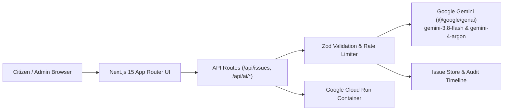

# CivicResolve — AI-Powered Civic Issue Reporting & Management Platform

**CivicResolve** simplifies how citizens report local infrastructure issues (potholes, burst water pipes, broken streetlights, overflowing garbage, drainage blockages) and helps municipal authorities classify, prioritize, route, and resolve them transparently using **Google Gemini** on **Google Cloud Run**.

---

## Core Features
- **Citizen Issue Reporting:** Submit complaints with title, description, location (with optional browser GPS assist), category (`Auto-Detect` or manual), and optional photo upload — plus 1-click realistic demo scenarios.
- **Google Gemini AI Classification (`@google/genai`):** Analyzes text + optional image using `gemini-3.8-flash` with strict Zod-validated structured JSON output (`response_format`) to determine standardized category, urgency level (`Low`–`Critical`), numeric urgency score (`1–100`), recommended municipal department, SLA window, crew dispatch checklist, and citizen safety advisory.
- **Issue Tracking Dashboard:** Live KPI overview, category distribution, search & status/priority filters, 3-stage visual progress stepper (`Reported → In Progress → Resolved`), and expandable full audit timeline (`Citizen → Gemini AI → Municipal Admin`).
- **Municipal Admin Dashboard:** Urgency-ranked triage queue to update ticket statuses, override priority, reassign departments, attach citizen-visible resolution notes, export CSV reports (with formula-injection protection), and generate a 1-click **Gemini AI Executive Dispatch Briefing** (supporting both `gemini-3.8-flash` and `gemini-4-argon`).
- **Streaming AI Civic Helper:** Real-time Server-Sent Events (SSE) citizen assistant powered by Gemini Interactions API with stateful multi-turn memory (`previous_interaction_id`).

---

## Architecture


---

## Engineering & Evaluation Highlights
- **Google Services:** Official `@google/genai` Interactions API (multimodal vision, structured JSON outputs, streaming SSE) + production **Google Cloud Run** container (`Dockerfile` with `/api/health`).
- **Security:** Server-only `GEMINI_API_KEY`, strict Zod validation, strict tracking-ID regex validation, sliding-window rate limiting (`src/lib/security.ts`), HTTP security headers (`next.config.ts`), sanitized API errors, CSV formula-injection escaping, and non-root Docker user (`nextjs:1001`).
- **Accessibility (WCAG 2.1 AA):** Skip-to-content link, semantic landmarks, ARIA `tablist`/`tab`/`tabpanel`, `aria-live="polite"`, `role="alert"`, `role="progressbar"`, and visible keyboard focus rings.
- **Testing:** Automated native test suite (`npm test` — 17 unit tests covering schemas, fallback classifier, store CRUD + audit timeline, rate limiting, error sanitization, and CSV escaping).

---

## Local Development & Verification
```powershell
npm install
# Add GEMINI_API_KEY to .env.local
npm test
npm run typecheck
npm run build
npm run dev
```

---

## Deploy to Google Cloud Run
### Option 1 — Google Cloud Console (GitHub Continuous Deploy)
1. Push this repo to GitHub.
2. Open [Cloud Run Console](https://console.cloud.google.com/run) → **Create Service** → **Continuously deploy from a repository**.
3. Select this repository → Build Type: **Dockerfile**.
4. Authentication: **Allow unauthenticated invocations**.
5. Under **Variables & Secrets**, add `GEMINI_API_KEY`.
6. Click **Create** and verify `<YOUR-CLOUD-RUN-URL>/api/health`.

### Option 2 — Google Cloud Shell (1 Command)
```bash
git clone <YOUR_GITHUB_REPO_URL> && cd <REPO_NAME>
gcloud run deploy civicresolve \
  --source . \
  --region asia-south1 \
  --allow-unauthenticated \
  --set-env-vars GEMINI_API_KEY="YOUR_GEMINI_API_KEY"
```

---

## Brief Project Description (Ready for Submission)
> CivicResolve is an AI-powered civic issue reporting and municipal triage platform built with Next.js, Google Gemini (`@google/genai`), and Google Cloud Run. Citizens can report local infrastructure issues—such as potholes, water leaks, broken streetlights, and overflowing waste—with location details and optional photos. Google Gemini automatically classifies each complaint, detects urgency and public safety impact, recommends the right municipal department, and generates actionable field-crew steps. Both citizens and administrators get real-time transparency through an interactive Issue Tracking Dashboard (`Reported → In Progress → Resolved`), an Admin Triage & Dispatch Dashboard with AI executive briefings, and a live streaming Civic AI Helper.
