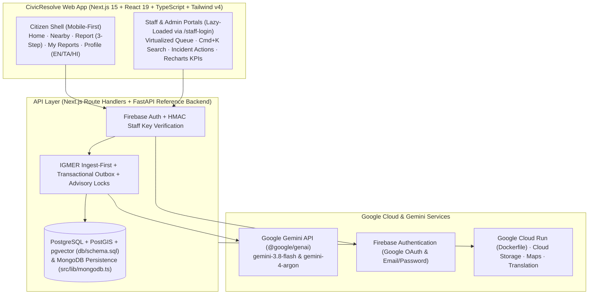

# CivicResolve — AI-Powered Civic Issue Reporting & Incident Clustering Platform

> **"One problem. Multiple citizens. One tracked incident."**
> **CivicResolve** simplifies how citizens report local infrastructure issues (potholes, burst water pipes, broken streetlights, overflowing garbage, sewage/drainage blockages) and helps municipal authorities classify, cluster, prioritize, route, and resolve them transparently using **Google Gemini**, **Firebase Authentication**, and **IGMER (Ingest-First Geospatial Multimodal Entity Resolution)**.

---

## Key Features

### 1. Citizen App (Mobile-First, English / தமிழ் / हिन्दी)
- **3-Step Guided Reporting (`ReportWizard`):**
  1. **What happened?** — Plain-language description, optional voice dictation (Web Speech API), up to **4 photos** (live camera capture or gallery upload, JPEG/PNG/WebP magic-byte validated, 5 MB limit, EXIF GPS stripped), and **10 ready-typed multilingual photo suggestions** in English, Tamil, and Hindi that appear when a photo is added.
  2. **Where is it?** — GPS pin with explicit location consent or nearby landmark fallback.
  3. **Check & Send** — Optional anonymous submission, idempotent retry-safe submission (`Idempotency-Key`), and instant Tracking ID (`CR-YYYY-NNNN`).
- **My Reports (Zero Placeholder Data):** Shows only the signed-in citizen's own submitted reports; new users see a clean empty state with a direct **Report a problem** action.
- **Nearby Incidents:** Lists active neighborhood incidents sorted by distance with priority and status badges.
- **Profile & Language Switcher:** Instant switching across **English**, **தமிழ் (Tamil)**, and **हिन्दी (Hindi)** persisted in `localStorage`.

### 2. Hidden Key-Only Department & Admin Portals
Staff portal entry is intentionally hidden from the citizen interface and accessible only via **`/staff-login`** (or keyboard shortcut **`Ctrl + Shift + L`** / `Cmd + Shift + L`):
- **Department Portal (`/authority`):** Virtualized incident queue (`react-virtuoso`), `⌘K` / `Ctrl+K` command-palette search (`cmdk`), and full incident management (**status transitions**, **priority override**, **department assignment**, **public citizen updates**, and **resolution photo upload**).
- **Admin Portal (`/admin`):** Animated KPI overview (`@number-flow/react`), lazy-loaded department workload chart (`recharts` with screen-reader table fallback), and full incident operations.

#### Demo Portal Access Keys (For Evaluation)
| Portal | Route | Demo Account | Default Access Key | Env Override |
|---|---|---|---|---|
| **Department Portal** | `/staff-login` → `/authority` | `dept.officer@civicresolve.in` | `DEPT-CIVIC-2026` | `DEPARTMENT_PORTAL_KEY` |
| **Admin Portal** | `/staff-login` → `/admin` | `admin@civicresolve.in` | `ADMIN-CIVIC-2026` | `ADMIN_PORTAL_KEY` |

### 3. IGMER — Ingest-First Geospatial Multimodal Entity Resolution
- **Priority 1 (Citizen Reliability):** Validates and persists citizen reports atomically with a **Transactional Outbox** event and `Idempotency-Key` deduplication before running asynchronous AI processing.
- **Priority 2 (10-Stage Multimodal Matching):** Multilingual text normalization (English + Tamil/Hindi civic lexicon), text & image embeddings, PostGIS `ST_DWithin` radial filtering, `pgvector` cosine retrieval, and weighted similarity (**Geographic 35% · Text 30% · Image 20% · Category 10% · Time 5%**) with **Adaptive Weight Normalization** when photographs are missing. Never merges on GPS proximity or image similarity alone.
- **Priority 3 (Concurrency Safety):** Per-locality advisory locking (`pg_advisory_xact_lock` / `withLocalityAdvisoryLock`) around match-or-create so 50+ simultaneous reports for the same physical issue cluster cleanly into **1 Master Incident** with zero race duplicates.
- **Priority 4–6 (Aggregation & Resilience):** Tracks supporting report counts, unique citizens, geographic centroid/spread, and volume-safe priority ceilings (a single exposed live wire is `Critical`, while report volume alone never escalates minor cosmetic issues to `Critical`).

---

## Architecture



---

## API Contract

| Method & Path | Description |
|---|---|
| `GET /api/health` | Service, Gemini API key, and MongoDB health status |
| `GET /api/me` | Returns authenticated `{ role, name }` |
| `POST /api/staff/login` | Verifies Department/Admin portal key and issues HMAC-signed token |
| `POST /api/reports` | `multipart/form-data` report submission (`description`, `lat`, `lng`, `landmark`, `anonymous`, up to 4 `images`, `Idempotency-Key`) → `{ trackingId }` |
| `GET /api/reports/mine?cursor=` | Paginated reports belonging only to the signed-in citizen |
| `GET /api/incidents/nearby?lat&lng&radius` | Public nearby incidents sorted by Haversine distance |
| `GET /api/incidents?cursor=` | Paginated master incidents queue |
| `GET / PATCH /api/incidents/:id` | Incident details & staff portal actions (status, priority, department, public update, resolution photo) |
| `GET /api/admin/overview` | Live KPI counts & department workload aggregates |
| `POST /api/igmer` | IGMER ingest, threshold config, outbox retry, and 50-citizen concurrency simulation |

---

## Security, Accessibility & Testing

- **Security:** Server-only `GEMINI_API_KEY`, Firebase ID token + HMAC staff token verification, sliding-window rate limiting, Zod schema validation, JPEG/PNG/WebP **magic-byte verification** + 5 MB cap, EXIF GPS stripping, HTTP security headers (`X-Content-Type-Options`, `X-Frame-Options: DENY`, `Referrer-Policy`, `Permissions-Policy`, `HSTS`), and CSV formula-injection escaping.
- **Accessibility (WCAG 2.1 AA):** Semantic landmarks, skip-to-content link, ≥ 44 px touch targets, status colors always paired with icon + text, visible keyboard focus rings, `aria-live="polite"` feedback, `prefers-reduced-motion` support, and screen-reader table fallback for charts.
- **Automated Tests (`npm test`):** **30/30 passing tests** covering Gemini configuration, Zod validation, fallback classification, issue store CRUD & audit timeline, RBAC & magic-byte checks, staff key auth, i18n, and **50-citizen concurrent load tests** (single incident clustering, two co-located incidents at identical GPS coordinates, and AI/DB fault resilience).
- **Data Retention & Synthetic Dataset Notice:** Seeded Chennai/Tamil Nadu municipal records are clearly flagged synthetic (`isSynthetic: true`); no live government system integration is claimed. Public endpoints never expose citizen emails or PII.

---

## Local Setup

```powershell
# 1. Install dependencies
npm install

# 2. Configure environment variables
Copy-Item .env.example .env.local
# Add GEMINI_API_KEY and NEXT_PUBLIC_FIREBASE_* keys in .env.local

# 3. Verify tests, types, and production build
npm test
npm run typecheck
npm run build

# 4. Run locally
npm run dev
```

Open **[http://localhost:3000](http://localhost:3000)** (Citizen App) or **[http://localhost:3000/staff-login](http://localhost:3000/staff-login)** (Department / Admin Portal).

---

## Deployment

### Google Cloud Run
```bash
gcloud run deploy civicresolve \
  --source . \
  --region asia-south1 \
  --allow-unauthenticated \
  --set-env-vars GEMINI_API_KEY="YOUR_KEY",NEXT_PUBLIC_FIREBASE_API_KEY="...",NEXT_PUBLIC_FIREBASE_AUTH_DOMAIN="...",NEXT_PUBLIC_FIREBASE_PROJECT_ID="...",NEXT_PUBLIC_FIREBASE_APP_ID="..."
```

### Vercel
1. Import [samcartier08-afk/civicresolve](https://github.com/samcartier08-afk/civicresolve) at [vercel.com/new](https://vercel.com/new).
2. Add `GEMINI_API_KEY` and the 4 `NEXT_PUBLIC_FIREBASE_*` keys under **Environment Variables**.
3. Deploy and add your live domain under **Firebase Console → Authentication → Settings → Authorized domains**.

---

## Submission Summary (Hack2Skill Requirement 4/4)
> **CivicResolve** is an AI-powered civic issue reporting and municipal incident-clustering platform built with Next.js, TypeScript, Google Gemini (`@google/genai`), Firebase Authentication, and Google Cloud Run. Citizens report local infrastructure issues in 3 simple steps with photos, GPS/landmark, voice input, and multilingual English/Tamil/Hindi support—without needing to know municipal department names. Using our **IGMER (Ingest-First Geospatial Multimodal Entity Resolution)** engine, every report is persisted reliably before Gemini classifies urgency, routes departments, and clusters duplicate citizen reports into one tracked master incident. Dedicated key-protected Department and Admin portals enable real-time triage, status updates, resolution photo evidence, and live workload analytics.
